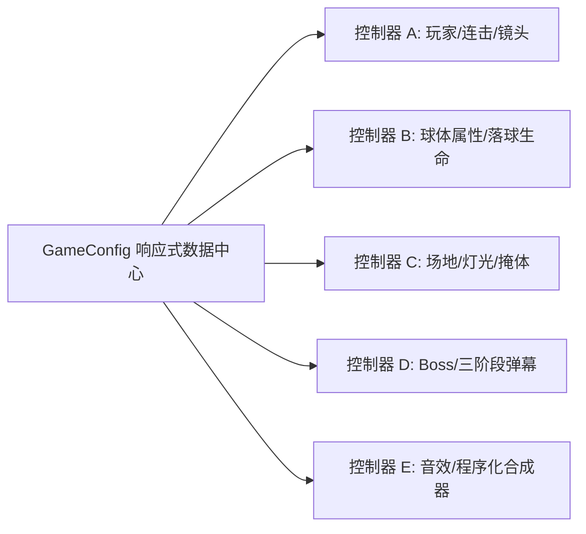

# Project: Dodgeball Boss Rush (弹反躲避球 Boss 战)
> **文档版本**：v1.5 全阶段需求汇总与系统架构设计总纲  
> **项目定位**：白盒几何原型验证 $\rightarrow$ 高打击感程序化战斗 MVP  
> **核心开发原则**：**数据驱动（Data-Driven）+ 零资产程序化音画（Procedural Audio & FX）**。严禁将任何核心数值硬编码！所有物理参数、角色冷却、判定时间窗、球体属性、连击系统、场地与灯光、Boss 攻击阶段、音效合成参数均统一纳管于全局响应式配置 `GameConfig` 中，并通过双端自适应的 **【策划实时调试台 (Design Inspector)】** 实现运行中零延迟热重载与配置导入导出。

---

## 目录 (Table of Contents)
1. [技术栈与核心工程架构 (Tech Stack & Architecture)](#1-技术栈与核心工程架构-tech-stack--architecture)
2. [双端 3C 与输入控制系统 (Controls, Character & Camera)](#2-双端-3c-与输入控制系统-controls-character--camera)
3. [核心战斗判定与状态机规范 (Combat FSM & Judgment)](#3-核心战斗判定与状态机规范-combat-fsm--judgment)
4. [Boss 阶段机制与胜负结算保护 (Boss Mechanics & Victory Freeze)](#4-boss-阶段机制与胜负结算保护-boss-mechanics--victory-freeze)
5. [五大策划实时调试控制台规范 (The 5 Design Inspector Controllers)](#5-五大策划实时调试控制台规范-the-5-design-inspector-controllers)
6. [原生 Web Audio 程序化音效引擎规范 (Procedural Audio Engine)](#6-原生-web-audio-程序化音效引擎规范-procedural-audio-engine)
7. [移动端响应式与视口自适应规范 (Mobile Responsive & Viewport Adaptation)](#7-移动端响应式与视口自适应规范-mobile-responsive--viewport-adaptation)
8. [界面 HUD 与街机动效规范 (HUD & Visual Polish)](#8-界面-hud-与街机动效规范-hud--visual-polish)
9. [球体主次分级与战场减负规则 (Core Dodgeball vs Minion Bullets)](#9-球体主次分级与战场减负规则-core-dodgeball-vs-minion-bullets)
10. [障碍物物理碰撞、转阶段无敌与 P3 破盾机制 (Obstacles Physics & Boss Invulnerability)](#10-障碍物物理碰撞转阶段无敌与-p3-破盾机制-obstacles-physics--boss-invulnerability)
11. [投球物理基准重构、弹幕随机洗牌与配置持久化 (Speed Fix, Formation Shuffle & LocalStorage)](#11-投球物理基准重构弹幕随机洗牌与配置持久化-speed-fix-formation-shuffle--localstorage)
12. [残影彻底清理、P3障碍物预警升起与Boss P2边缘瞬移机动 (Trail Cleanup, P3 Obstacle Fissures & Boss P2 Edge Teleportation)](#12-残影彻底清理p3障碍物预警升起与boss-p2边缘瞬移机动-trail-cleanup-p3-obstacle-fissures--boss-p2-edge-teleportation)

---

## 1. 技术栈与核心工程架构 (Tech Stack & Architecture)

* **运行环境**：Web 浏览器即开即玩（HTML5 Canvas 2D），支持 PC 键鼠与移动端触屏无缝自适应，具备原生 App 级的防误触与防滚动体验。
* **分层架构设计**：
  * **配置层 (`js/config.js`)**：单例化 `GameConfig`，包含预设管理器（Preset Manager）、事件发布/订阅系统（Pub/Sub）、深拷贝隔离与 JSON 格式导入导出。
  * **音频层 (`js/audio.js`)**：纯原生 Web Audio API 程序化合成引擎 `SoundManager`（完全不依赖任何外部 `.mp3` / `.wav` 资源），包含 Autoplay 解锁与多通道音效合成。
  * **数学与物理层 (`js/physics.js`)**：纯正交 2D 碰撞判定（圆-圆、圆-胶囊、圆-边界）、入射/反射向量计算、折射偏转、阻尼插值、伪 45 度投影坐标映射。
  * **粒子与表现层 (`js/particles.js`)**：无垃圾回收压力（GC-friendly）的粒子池系统，支持火花碎片、环形冲击波、动态浮动跳字、冲刺拖尾与落球拾取光环。
  * **实体与状态机层 (`js/player.js`, `js/boss.js`, `js/ball.js`, `js/arena.js`)**：解耦的面向对象实体类，基于离散状态机（FSM）驱动动作与判定流转。
  * **交互与视口层 (`js/input.js`, `js/inspector.js`, `js/game.js`)**：跨平台统一输入映射器、移动端 90° 横屏虚拟化容器、全响应式摄像机自适应系统与 5 大调试控制器。

---

## 2. 双端 3C 与输入控制系统 (Controls, Character & Camera)

### 2.1 跨平台双端操作映射
系统自动识别当前设备（触屏 Touch vs 键鼠 PC），并在调试台提供强制模式切换：

| 操作行为 | PC 端 (键鼠) | 移动端 (Touch 虚拟按键) | 核心交互逻辑与手感要求 |
| :--- | :--- | :--- | :--- |
| **角色走位** | `W / A / S / D` 或方向键 | 左侧动态浮动虚拟摇杆 | 360° 模拟量无死角移动，松手即停，无滑动惯性延迟 |
| **主动接球 / 弹反** | 鼠标左键 (LMB) 点击 | 右侧【CATCH 接球】按键点按 | 进入接球时间窗；挥空触发硬直与冷却，成功进入持球瞄准 |
| **反向蓄力瞄准** | 按住左键不放并反向拖动鼠标 | 按住接球键不放并在屏幕滑动 | 类似弹弓（Slingshot）：向后反向拉扯，角色脚下显示蓄力轨迹虚线与箭头 |
| **松手发射投掷** | 松开鼠标左键 | 抬起触控手指 | 将球以当前蓄力速度与角度射向目标，若处于完美接球加成则附加暴击 |
| **极限闪避 (Dash)** | 鼠标右键 (RMB) 点击 | 右侧【DASH 闪避】按键点按 | 向当前走位方向快速突进，附带无敌帧，可强制打断挥空减速硬直 |
| **场地落球拾取** | 走入落球光环内点按 LMB | 走入落球光环内点按 CATCH | **严禁碰撞自动吸球**，必须主动按键拾取，防走位误触打断节奏 |
| **调参调试台** | 键盘 `Tab` 键快速开闭 | 右上角微型悬浮按钮 `[⚙️]` | 打开调试面板时**自动暂停游戏**，关闭后立即恢复 100% 战斗视野 |

### 2.2 反向瞄准手感与阻尼微调控件 (Aim Assist & Smoothing)
为解决“接到球后调整角度过于顺滑导致微操瞄准困难”的问题，输入层集成了高精度滤波平滑算法，并在配置台开放实时调节：
* **`Inverted Aim Drag`（反向弹弓拉拽开关）**：默认开启（向后拉、向前射）。
* **`Aim Sensitivity`（瞄准灵敏度）**：调节范围 `0.2` ~ `2.5`（默认 `1.0`），控制拖拽位移转换为瞄准旋转角的速度。
* **`Aim Smoothing`（瞄准平滑阻尼）**：调节范围 `0.05`（重度机械阻尼，超稳定）~ `1.0`（纯线性瞬时吸附，无阻尼），默认 `0.35`，消除手部细微生理抖动。
* **`Aim Deadzone`（瞄准死区半径）**：默认 `16px`，拖拽距离小于死区时不改变角度，防止微小误触。
* **`Aim Angle Snap`（角度微吸附）**：可选 `0°`（自由平滑）、`5°`（微量刻度吸附）、`15°`（强步进吸附）。

---

## 3. 核心战斗判定与状态机规范 (Combat FSM & Judgment)

### 3.1 接球时间窗与双重判定（Perfect Parry vs Good Catch）
当飞来的敌方球体接触玩家接球判定区时，根据按下接球键至球体接触的时差进行毫秒级判定：
1. **【完美接球 Perfect Parry】**（极短时间窗，默认接触前 `0.12s` 内）：
   - **视觉冲击**：屏幕右侧中间弹出醒目金黄色 **`PERFECT PARRY!`** 街机风格发光 Banner，展示当前连击伤害倍率；全场触发 `0.06s` 强顿帧（Hitstop）与镜头微震。
   - **时间机制**：立即激活全场**全局子弹时间（Bullet Time）**，全场降速至 `0.15x`（持续 `1.8s`，可调），镜头动态推近。
   - **投掷强化**：赋予该球 **`Perfect Throw` 暴击属性**（投出初速度 `x1.6`，伤害倍率 `x2.0`），且不计入常规接球冷却。
   - **音效反馈**：合成高频清脆金属碰撞打铁声（1200Hz + 2400Hz 叠加 4500Hz 冲击噪波，类似《只狼》弹刀）。
2. **【普通接球 Good Catch】**（常规时间窗，默认接触前 `0.25s` 内）：
   - 屏幕右侧中间弹出亮绿色 **`GOOD CATCH!`** Banner；
   - 触发较短子弹时间，球被安全收纳进手中，投出伤害按常规倍率计算；
   - 音效合成饱满的护盾吸纳声（300Hz -> 600Hz 上扬波）。

### 3.2 接球挥空惩罚机制（Catch Whiff Penalty）
当玩家在判定范围内无球时按下了接球键，触发高强度犯错惩罚反馈，制造收招硬直与破绽感：
1. **视觉锁死强反馈**：
   - **判定圈坍缩锁死**：判定圈瞬间变为刺眼的警示暗红色，向内坍塌并呈现带红色交叉斜杠（X）的锁死底圈，跟随玩家移动直至 CD 转好。
   - **角色水平微抖动（Horizontal Jitter）**：挥空瞬间角色触发持续 `0.15s` 的高频左右抖动（模拟用力过猛重心失衡），角色本体颜色暗化变灰红。
   - **头顶浮动告警**：头顶弹出短促醒目的 `❗ WHIFF!` 红色跳字与感叹号。
   - **拒绝输入卡壳反馈**：在挥空冷却未转好时再次狂按接球键，锁死圈高亮抽搐闪烁，UI 接球按键触发左右摇晃动画（`shake-reject`），播放机械卡壳锁定音（150Hz 双连发方波脉冲）。
2. **操作体感惩罚（Movement Slowdown）**：
   - 挥空瞬间进入身体失衡硬直，移速降低至基础移速的 `40%`（可调），持续 `0.35s` 后平滑复原。
   - **高玩补救机制（Dash Cancels Whiff）**：若在减速期间玩家按下了【闪避键（Dash）】且闪避不在 CD 中，允许**用闪避动作强制取消挥空减速硬直**。
3. **调试台独立参数**：
   - `Whiff Slowdown Switch`（挥空减速开关，默认 `true`）。
   - `Whiff Slowdown Multiplier`（保留移速比率，`0.0` 完全定身 ~ `1.0` 不减速，默认 `0.4`）。
   - `Whiff Slowdown Duration`（减速时长，默认 `0.35s`）。
   - `Dash Cancels Whiff`（闪避取消硬直开关，默认 `true`）。

### 3.3 地面落球限时消失机制（Grounded Ball Lifetime）
球体被反弹或撞墙落到地面变成“中立可拾取球（Grounded）”后，具备独立的生命周期：
1. **生命周期倒计时**：
   - 调试台参数：`Ground Lifetime Switch`（默认开启）与 `Ground Lifetime Duration`（停留时长，`1.0s` ~ `15.0s`，默认 `4.0s`）。
   - 地面拾取光环内圈绘制顺时针缩减的细线倒计时进度弧。
2. **临界濒死预警（Blinking）**：
   - 在消失前的最后 `1.2s` 内，拾取光环与球体切换为警告暗红色，进入高频闪烁状态。
3. **安全坍缩消散**：
   - 倒计时归零时，球体原地缩小坍缩并伴随少量灰白色粒子消散（不造成任何爆炸伤害）。若玩家在中途成功拾取，立即清除倒计时。

### 3.4 手持过热自爆（Overheat Explosion）
* 玩家持球（拖拽瞄准中）时启动倒计时（默认 `2.5s`）。
* 在最后 `1.0s` 临界期，触发急促单步方波蜂鸣（Overheat Tick）。
* 倒计时归零时在玩家手中直接自爆，产生大范围红光冲击波，对玩家自身造成扣血伤害并强制重置持球状态。

---

## 4. Boss 阶段机制与胜负结算保护 (Boss Mechanics & Victory Freeze)

### 4.1 Boss 基础状态与原型定位
* **原型**：以《以撒的结合》“妈心（Mom's Heart）”为原型，初始默认固定在场地北侧边缘版边（或中央固定 / 缓慢游走）。
* **体型与血量**：默认最大 HP `600`，碰撞体半径默认 `55px`（支持调节）。

### 4.2 三阶段攻击波次状态机
| 阶段划分 | HP 阈值区间 | 发射间隔 (Fire Rate) | 发射源 (Emitter Source) | 弹幕阵型 (Formation) | 分配球种 (Preset) |
| :--- | :--- | :--- | :--- | :--- | :--- |
| **Phase 1** | 100% ~ 70% | 1.8s | Boss 本体发射 | 扇形散射 (Fan Spread 5发 60°) | 标准白球 (Preset 1) |
| **Phase 2** | 70% ~ 30% | 1.3s | 本体 + 版边墙壁混合 | 螺旋连射 (Spiral Rate 7) | 混合球种 (Mixed) |
| **Phase 3** | 30% ~ 0% | 0.85s | 四周版边交叉火力 | 360° 环形弹幕 (Ring Count 12) | 重型红球 (Preset 2, 不可直接接) |

### 4.3 击败 Boss 瞬间冻结战斗与全场弹幕保护（Victory Freeze & Bullet Clear）
防止玩家在耗尽心血击败 Boss 的最后一瞬间被场上残余的飞行球误伤砸死：
1. **胜局瞬间锁定与绝对无敌**：
   - 当 Boss HP `<= 0` 的那一帧，立即设置 `isVictory = true`，玩家立刻获得绝对无敌状态（`isInvulnerable = true`），强制中断手持球的过热自爆逻辑并复原状态。
   - 主战斗循环与 `checkPlayerBallCollisions()` 判定立即对 Boss 和飞行球施加守卫中断，终止一切敌方子弹的发射与伤害更新。
2. **全场弹幕烟花清场演出**：
   - 场上所有现存的敌方飞行球、地面落球、墙壁发射器瞬间清除，并在原位爆裂转化为金黄与亮青色庆祝火花碎屑与冲击波。
3. **慢动作顿帧与结算画面衔接**：
   - 伴随强烈的屏幕震颤、Boss 爆裂大冲击波、`BOSS SLAIN!` 跳字以及 `0.5s` 的慢动作顿帧（Hitstop）。
   - 同时播放辉煌的胜利大三和弦琶音（`victoryFanfare`）。
   - 随后平滑冻结主画面并弹出清晰的 **【VICTORY / 击破达成!】** 结算卡片（包含连击数统计与重新挑战按钮），确保 100% 绝对安全结算。

---

## 5. 五大策划实时调试控制台规范 (The 5 Design Inspector Controllers)

调试台包含 5 个主选项卡，所有数据双向绑定全局响应式 `GameConfig`：

### 控制器 A：玩家、连击与镜头 (`Player & Combo & Camera`)
* **玩家生存与机能**：`Max HP` (50~300)、`Move Speed` (150~600)。
* **接球与挥空判定**：`Catch Cooldown Switch & Time` (0.1~3.0s)、`Perfect Window` (0.05~0.3s)、`Good Window` (0.1~0.5s)、`Whiff Slowdown Switch`、`Whiff Slowdown Multiplier` (0.0~1.0)、`Whiff Slowdown Duration` (0.1~1.5s)、`Dash Cancels Whiff` 开关。
* **闪避机能**：`Dash Cooldown Switch & Time` (0.2~3.0s)、`Dash Distance` (80~400px)、`Dash Duration`、`Dash I-Frames Duration`。
* **子弹时间**：`Bullet Time Scale` (0.05~0.5x)、`Bullet Time Duration` (0.5~5.0s)、`Perfect Throw Speed & Damage Multipliers`。
* **连击系统 (Combo)**：`Reset Timer` (1.0~10.0s)、`Base Multiplier` (0.05~0.5/Hit)、`Max Multiplier Cap` (1.5~10.0x)。
* **镜头与震屏**：`Camera Zoom` (0.5~2.0)、`Screen Shake Intensity & Duration`、`Dynamic Zoom on Bullet Time` 开关与推近倍率。

### 控制器 B：球体属性与落球生命周期 (`Ball Property Inspector`)
* **球种预设体系**：预设 1 (标准白球: 可接/弹墙2次)、预设 2 (重型红球: 空中不可接/撞墙范围爆炸/伤害50)、预设 3 (弧线紫球: 走正弦波轨迹)、自定义预设。
* **基础参数**：初速度、玩家投掷速度加成比率、半径、基础伤害、轨迹模式（直线 / 正弦 / 弱寻的追踪）。
* **核心拦截规则**：`Can Direct Catch` 开关、`Overheat Explode Switch & Timer`。
* **版边碰撞模式**：穿透边界销毁 (Pass) / 弹墙不减速 (Bounce，可调最大反弹次数) / 撞墙范围爆炸 (Explode，可调 AOE 半径与伤害)。
* **命中 Boss 后行为**：命中销毁 (Destroy) / **击中回弹总开关 (Rebound on Hit)**。
* **回弹可调参数**：
  - `Rebound Angle Mode`：**物理反射 (Reflection)** / **固定折射 (Refraction)** / **随机扇区 (Random)**。
  - `Rebound Angle Variance`：偏移角度范围滑块。
  - `Rebound Distance`：回弹飞出距离与抛物线高度。
* **地面落球限时消失机制**：
  - `Ground Lifetime Switch`（默认 `true`）。
  - `Ground Lifetime Duration`（默认 `4.0s`，滑块范围 `1.0s` ~ `15.0s`）。

### 控制器 C：竞技场、灯光与障碍物 (`Arena & Environment`)
* **几何拓扑**：`Shape`（矩形 Rectangle / 圆形 Circle / 八边形 Octagon）、宽高尺寸（Width & Height / Radius）。
* **视觉投影**：`Perspective Y-Scale`（伪 45 度纵向压扁系数，`0.5` ~ `1.0` 平滑无缝变形）。
* **灯光与氛围**：环境底色（Ambient Color）、环境光强、角色与球体发光光晕（Glow Intensity）、地面投影阴影透明度。
* **掩体生成器**：障碍物数量（0~8）、尺寸、是否可被球体砸碎、排布预设（四角对称 / 环形阵列 / 随机分布 / 无）。

### 控制器 D：Boss 阶段与攻击波次 (`Boss & Pattern`)
* **Boss 状态**：最大生命值、碰撞体半径大小、初始站位（北侧边缘固定 / 场地中央固定 / 漫游移动）。
* **Phase 1 / 2 / 3 阶段独立参数**：
  - 血量阈值区间（最大/最小百分比）。
  - 发射间隔（秒）。
  - 发射源：Boss 本体 / 四面墙壁版边 / 双方同时发射。
  - 阵型算法：单发狙击 (Single) / 扇形散射 (Fan Spread [发数与角度]) / 360° 环形弹幕 (Ring [发数]) / 螺旋弹幕 (Spiral [旋转速率])。
  - 当前波次球种指定（白球 / 红球 / 紫球 / 混合）。

### 控制器 E：音效控制台与程序化合成器 (`Audio & SFX Inspector`)
* **引擎状态监测**：实时显示 Web Audio 状态（`ACTIVE / 48000Hz` 或 `SUSPENDED`），并提供醒目的 `[🔊 点击测试并立即激活音频通道]` 按钮。
* **全局总线控制**：
  - `Master Mute`（全局静音开关，默认 `false`）。
  - `Master Volume`（主音量滑块 `0.0 ~ 1.0`，步长 `0.05`，默认 `0.7`）。
* **12 格程序化音效自检试听按键矩阵**：包含打铁、接球、挥空、CD拒绝、子弹时间、射球、命中重击连击、弹墙、爆炸、闪避、受击、胜利和弦，点击即可直接无延迟发声测试。

---

## 6. 原生 Web Audio 程序化音效引擎规范 (Procedural Audio Engine)

### 6.1 浏览器 Autoplay 挂起锁的全局解锁架构
现代浏览器对未经用户手势授权的音频上下文默认处于 `suspended` 挂起状态。引擎实装了全局保障机制：
1. **多事件捕获监听**：在 `window` 与 `document` 的顶层事件捕获阶段（`capture: true, passive: true`）监听 `pointerdown`、`mousedown`、`touchstart`、`keydown`、`click` 5 类事件。
2. **状态监测与唤醒**：一旦捕获到用户交互且 `audioCtx.state === 'suspended'`，立即触发 `audioCtx.resume()` 解锁声音硬件输出通路。
3. **预生成白噪音池**：预先分配 1 秒长度的 `Float32Array` 白噪音缓冲区，所有爆破与风噪复用该缓冲，实现 0 GC 延迟合成。

### 6.2 9+ 核心战斗音效合成物理公式

| 音效名称 | 触发时机 | 振荡器与噪声架构 (Waveform & Nodes) | 频率与包络特征 (Envelope & Sweep) | 听感目标 |
| :--- | :--- | :--- | :--- | :--- |
| **`perfectParry`** | 完美接球瞬间 | 双正弦波 + 三角波 + 4500Hz 带通白噪 | `1200Hz + 2400Hz + 3600Hz` 极速起音，`0.04s` 噪声爆发，`0.35s` 衰减 | 《只狼》清脆金属弹刀打铁声 |
| **`goodCatch`** | 普通接球或捡球 | 单正弦波 + 三角波 | 正弦波 `300Hz -> 600Hz` 快速上扬，三角波 `120Hz -> 55Hz` 沉闷冲击 | 护盾能量吸纳入袋声 |
| **`whiff`** | 接球挥空失误 | 锯齿波 + 低通白噪音 + 低正弦波 | 噪声 `1200Hz -> 200Hz` 扫频，锯齿波 `180Hz -> 70Hz` 快速下坠 | 低沉干瘪漏气与身体失衡声 |
| **`cooldownDeny`** | CD 期间狂按 | 低通滤波方波双连发脉冲 | 间隔 `0.048s`，两段方波 `150Hz` 与 `130Hz`，时长 `0.035s` | 短促机械卡壳拒绝“咔哒”声 |
| **`bulletTimeEnter`** | 进入子弹时间 | 三角波 Sub-bass + 主低通滤波 | `220Hz -> 45Hz` 指数下潜，主低通滤波器迅速从 20000Hz 关至 `750Hz` | 水下慢放与空间深沉下潜感 |
| **`playerThrow`** | 松手将球射出 | 锯齿/三角波 + 带通空气扰动白噪 | 音调 `200Hz -> 500Hz`（完美时为 600Hz），风噪 `600Hz -> 2400Hz` | 强力破空呼啸飞射声 |
| **`bossHit`** | 球体砸中 Boss | 强 Punch 正弦波 + 爆裂白噪 + 连击谐波 | 正弦波 `120Hz -> 30Hz`，连击递增时音阶上扬：`pitch *= 1 + (combo - 1) * 0.05` | 巨兽中弹重炮轰击与连击节奏感 |
| **`wallBounce`** | 碰撞竞技场版边 | 纯正弦波弹性滑音 | `400Hz -> 550Hz` 快速上扬，`0.08s` 极速释放 | 清脆弹性乒乓球反弹声 |
| **`wallExplode`** | 版边爆炸/自爆 | 低通漫反射白噪 + 次低频正弦波 | 白噪 `500Hz -> 50Hz` 长混响 `0.6s`，次低频 `90Hz -> 25Hz` 轰鸣 | 厚重大爆炸冲击波 |
| **`dash`** | 玩家按键闪避 | 高通滤波风声 + 正弦滑音 | 噪声高通 `1000Hz -> 400Hz`，正弦波 `380Hz -> 750Hz` | 轻快凌厉的气流瞬移呼啸 |
| **`playerHurt`** | 玩家受到伤害 | 失真锯齿波下降报警 + 断裂中频噪波 | 锯齿波 `260Hz -> 80Hz` 下行，带通噪波 `1500Hz` 击打 | 刺耳急促的受挫警示声 |
| **`victoryFanfare`**| 击破 Boss 胜利 | 4 声部纯三角波大三和弦琶音 | C5 (`523Hz`) - E5 (`659Hz`) - G5 (`784Hz`) - C6 (`1046Hz`) 渐强延音 | 辉煌庄严的大捷和弦 |
| **`overheatTick`** | 手持过热自爆前 | 高频方波脉冲 | 单步边缘检测触发，`800Hz` 方波，时长 `0.04s` | 迫在眉睫的定时炸弹倒计时声 |

---

## 7. 移动端响应式与视口自适应规范 (Mobile Responsive & Viewport Adaptation)

针对手机移动端屏幕尺寸受限、手持遮挡等痛点，确立了一体化移动端重构规范：

### 7.1 HTML Viewport 与全局防滑动手势锁
* `<meta name="viewport" content="width=device-width, initial-scale=1.0, maximum-scale=1.0, user-scalable=no, viewport-fit=cover">` 强制声明，严禁页面双击缩放。
* `html, body` 与 `#app-container` 强制设定 `overflow: hidden; touch-action: none; user-select: none; -webkit-user-select: none; overscroll-behavior: none;`，彻底杜绝拉扯弹弓瞄准时触发的浏览器下拉刷新或橡皮筋回弹。

### 7.2 策划调试台移动端底部抽屉化改造（核心防遮挡）
* **设备判断（`width <= 900px` 或 Touch Device）**：
  - **默认完全折叠**：初始化时确保 `panel.classList.add('collapsed')`，严禁启动时遮挡屏幕。
  - **右上角微型齿轮悬浮按键**：收缩为 `36px × 36px` 半透明方块按钮 `[⚙️]`（文字隐藏），位于 `top: 10px; right: 10px;`，绝不干扰中央 Boss 血条。
  - **底部半屏抽屉（Drawer）**：展开时面板固定于屏幕底部，高度最大占屏幕 `60vh`，顶部带圆角与暗色阴影；内部支持流畅垂直触控滚动；面板顶部提供醒目的高亮 `[✕ 关闭并继续]` 按钮，点击立即解除暂停恢复 100% 战斗视野。

### 7.3 战斗 HUD 避让与轻量化排布
* **穿透点击**：所有 HUD 容器统一标记 `pointer-events: none`，滑动穿透不阻碍战斗操作。
* **顶部 Boss 血条压缩**：手机端宽度压缩为 `min(58vw, 360px)`，高度压缩至 `8px`，紧贴顶部 `8px` 处。
* **玩家血条与 CD 移至顶部左上角**：
  - 彻底移离左下角（移至 `top: 8px; left: 8px;`），尺寸微缩至 `68px`，**彻底释放了屏幕左下角的虚拟摇杆走位区，实现 0 按键重叠**！
  - 横屏切换与音频测试按钮紧凑收纳在玩家血条正下方（`top: 48px`）。
* **自动隐藏 PC 键位提示**：手机端完全隐藏 PC `WASD/LMB/RMB` 提示面板。

### 7.4 虚拟摇杆与右侧按键轻量化与高透防遮挡
* **尺寸微调**：左侧摇杆底座直径控制在 `100px`（摇杆帽 `42px`，最大行程半径 `36px`）；右侧【接球键】直径 `68px`，【闪避键】直径 `60px`（稍向下偏移 `4px`，贴合大拇指活动弧线）。
* **高透防遮挡（35% $\rightarrow$ 85%）**：
  - **静止未按时**：不透明度设为 `opacity: 0.35`，采用 1.5px 极细边框与半透明暗色背景，玩家能直接看透下方场地与落球；
  - **手指按压与拖拽瞄准时**：瞬时提升至 `opacity: 0.85` 并伴随高光反馈。

### 7.5 竞技场画布全屏自适应缩放（Auto-Fit Arena Camera）
在相机渲染循环中实装动态几何自适应缩放算法：
$$\text{autoScale} = \min\left(1.0, \; \min\left(\frac{W_{\text{screen}}}{W_{\text{arena}} + \text{paddingX}}, \; \frac{H_{\text{screen}}}{H_{\text{arena}} + \text{paddingY}}\right)\right)$$
* `paddingX = 80px, paddingY = 110px` 提供四周呼吸安全边距。
* 无论玩家使用物理横屏、旋转横屏还是手机竖屏，整个竞技场的上下左右四面墙壁均居中完整展示在视野内，且四周不会与 HUD 冲突。

---

## 8. 界面 HUD 与街机动效规范 (HUD & Visual Polish)

1. **右侧中间街机风判定提示（Right-Center Arcade Judgment Banner）**：
   - 为避免头顶跳字遮挡走位，成功触发接球判定时，在屏幕右侧居中边缘（`top: 36% ~ 48%; right: 12px ~ 14%`）弹出醒目的街机评级：
     - **`PERFECT PARRY!`**：金黄/亮青色重叠发光字体，斜切缩放动效（Scale 1.15 $\rightarrow$ 1.0, Skew -14° $\rightarrow$ -6°），附带当前连击倍率；
     - **`GOOD CATCH!`**：亮霓虹绿色字体；
     - 停留 `0.85s` 后滑出淡出，支持连击覆盖重置动画。
2. **失误警戒头顶保留**：接球挥空的 `❗ WHIFF!` 仍保留在玩家角色头顶正上方，加深犯错记忆。
3. **连击指示器 (Combo HUD)**：位于顶部右侧，实时展示连击数 `xN`、当前伤害百分比倍率（如 `145% DMG`）以及平滑递减的断连进度条。
4. **弹道预测与弹弓拉力线**：反向拖拽瞄准时，以角色为中心绘制动态蓄力张力拉索、虚线瞄准轨迹以及第一段墙壁反射预测线。
5. **胜利与战败结算弹窗**：居中响应式卡片，展示击破状态、最终连击峰值与重玩按钮，具备移动端全屏防溢出适配。

---

## 9. Boss 攻击节奏重构、弹幕分级与球体留存淘汰规则 (Boss Pacing, Bullet Hierarchy & Ball Retention)

为了解决高阶段（Phase 2/3）飞行弹幕过于密集、地面落球过多导致的视觉混乱与负反馈，系统重构了球体分级、留存淘汰规则与 Boss 攻击呼吸节奏流。

### 9.1 球体主次分级系统 (Bullet Hierarchy)
将场上弹幕从单一种类拆分为两级实体：
1. **核心交互球 (Core Dodgeball)**：
   - **视觉特征**：全尺寸半径（默认 14px）、高对比度白色高亮描边、高光镜面核心、明亮长拖尾。
   - **机制特性**：拥有完整接球判定（可普通接球、完美招架打铁）、墙壁反弹无损速属性；击中 Boss 时触发抛物线回弹，落入地面转化为可拾取落球。每波齐射中严格限制仅生成 1~2 颗。
2. **普通能量弹 (Minion Hazard Bullet)**：
   - **视觉特征**：微缩尺寸（半径为核心球的 50%，约 7px）、半透明暗红/紫粉色调、短促淡色拖尾。
   - **严格限制**：
     - **不可被接球**：玩家按接球键无法拦截（提示 `UNBLOCKABLE` 并受到伤害，但可通过普通闪避或完美闪避触发无伤与魔女时间）；
     - **触墙即灭（0 次反弹）**：触碰任何竞技场边界瞬间碎裂消散，绝不反弹；
     - **绝不回弹落地留存**：即使击中目标也直接碎裂，杜绝污染地面环境。
   - **阵型混入机制 (`mixMinionBullets`)**：在扇形（Fan）与环形（Ring）阵型中，中心 1 颗保留为核心交互球，边缘其余弹幕自动降级为普通能量弹。齐射后约 1 秒内杂弹即全部撞墙清空，画面迅速恢复清爽。

### 9.2 同屏留存与 FIFO 淘汰上限规则 (Retention & FIFO Caps)
在 `Ball Property Inspector` 中新增同屏管控体系，从源头杜绝落球堆积与滚雪球效应：
1. **地面落球数量上限 (`maxGroundedBalls`)**：
   - 滑块范围 `1 ~ 5`，**默认推荐值 `2 颗`**。
   - **先进先出 (FIFO) 淘汰机制**：当场地内已存在 2 颗地面落球且又有新球着陆时，系统自动选取场地上停留时间最久的一颗球，触发红色粒子爆散并立即销毁，确保地面永远保持清爽有序。
2. **存活核心球同屏上限 (`maxActiveCoreBalls`)**：
   - 滑块范围 `1 ~ 6`，**默认推荐值 `3 颗`**。
   - 当场上存活的核心球（飞行中 + 抛物线中 + 地面留存）总数达到上限时，Boss 发动后续攻击时自动将本该发射的核心球降级为普通能量弹，阻止无限产球滚雪球。
3. **仅玩家投掷击中 Boss 掉球 (`onlyPlayerThrownBallsDrop`)**：
   - 布尔开关，默认开启。
   - Boss 自发弹幕即使耗尽反弹次数触墙也直接销毁；唯有玩家成功接球并将球掷中 Boss 时，球体才回弹至地面成为下一轮拾取弹药，构筑“接球 $\rightarrow$ 瞄准投掷 $\rightarrow$ 造成伤害并掉球 $\rightarrow$ 拾取循环”的严密正反馈闭环。
4. **地面落球限时消失机制 (`groundLifetime`)**：
   - 默认开启，停留时长 `4.0s`（滑块 `1.0s ~ 15.0s`）。
   - 落地时在拾取光环内显示顺时针衰减进度弧线；最后 `1.2s` 进入高频闪烁红光预警，归零后坍缩销毁。

### 9.3 Boss 攻击节奏循环状态机 (Pacing Loop: Telegraph -> Fire -> Rest)
彻底抛弃无脑连续倾泻弹幕，构建具备清晰“回合交互博弈感”的三段式节奏循环：
1. **预警阶段 (Telegraph Phase，默认 0.5s)**：
   - 齐射前 `0.5s`，Boss 进入充能聚气，外环与本体高频闪烁蓄力；
   - 在 Boss 与玩家之间实时投射高亮红光瞄准激光虚线，扇形阵型附加半透明红色预警扇区（Telegraph Hazard Cone），给予玩家充足的走位预判与预瞄窗口。
2. **发射瞬间 (Fire Instant)**：
   - 预警计时归零瞬间发射弹幕，伴随清脆发射音效。
3. **停火呼吸窗口 (Wave Rest Interval)**：
   - 齐射后 Boss 进入完全停火的游走待机状态，保障玩家有充裕时间移动接球并反向蓄力瞄准：
     - **Phase 1（100% ~ 70% HP）**：默认间隔调优为 **`2.8s`**（单发狙击核心球，节奏舒缓，适合新手磨练接球手感）；
     - **Phase 2（70% ~ 30% HP）**：默认间隔调优为 **`3.0s`**（扇形 5 连发：仅中央 1 颗核心球，两侧 4 颗杂弹。杂弹 1 秒内撞墙消失，玩家享有整整 2 秒纯净反打窗口）；
     - **Phase 3（30% ~ 0% HP）**：默认间隔调优为 **`2.6s`**（四周墙壁在预警起始发射普通能量弹逼迫走位，0.6s 后 Boss 本体现身发射核心球，层次分明）。
4. **瞄准保护机制 (Aiming Window Protection)**：
   - 当玩家处于按住蓄力瞄准（`PlayerState.HOLDING_AIM`）或子弹时间状态时，Boss 的波次呼吸计时器动态冻结暂停，绝对不会在玩家专注拖拽瞄准时偷袭发射子弹。

### 9.4 策划调试面板 (Inspector) 扩展控件
1. **`Ball Property Inspector`（控制器 B）新增**：
   - `同屏与留存管控 (Retention & Caps)` 分组：
     - `地面落球上限 (Max Grounded Balls)`：滑块 `1 ~ 5`，默认 `2`。
     - `存活核心球上限 (Max Active Core Balls)`：滑块 `1 ~ 6`，默认 `3`。
     - `仅击中Boss产生落球 (Only Player Thrown Drops)`：开关，默认 `true`。
2. **`Boss Inspector`（控制器 D）新增**：
   - `攻击节奏与弹幕管控 (Pacing & Hazard Control)` 分组：
     - `发射预警时间 (Telegraph Duration)`：滑块 `0.2s ~ 1.0s`，默认 `0.5s`。
     - `阵型混入普通能量弹 (Mix Minion Bullets)`：开关，默认 `true`。
     - `✨ [一键重置为清爽推荐配置]`：高亮预设按钮，一键将上述全部节奏、上限、杂弹参数重置为最佳手感平衡值。
   - Phase 1 / Phase 2 / Phase 3 中将原本的 `发射间隔 (Fire Interval)` 正式更名为 `波次停火呼吸时间 (Wave Rest Interval)`，并分别设定默认值为 `2.8s / 3.0s / 2.6s`。

---

## 10. 障碍物实体物理碰撞与 Boss 阶段无敌/破盾机制 (Obstacle Physical Collision & Boss Invulnerability / P3 Shield Break)

为了提升战斗的战术纵深与关卡阶段目标感，系统实装了障碍物的完整物理碰撞规则，以及 Boss 的转阶段幽灵无敌与 P3 破盾机制。

### 10.1 障碍物物理碰撞与阵营交互规则
1. **障碍物体征与视觉反馈**：
   - 每个障碍物拥有独立的 `HP` 与 `MaxHP`（默认 `75 HP`，相当于玩家投掷 `2~3` 次击碎）；
   - 顶部环绕简洁的科技感环形耐久仪表（绿 $\rightarrow$ 黄 $\rightarrow$ 红），并在耐久低于 `70%` 与 `35%` 时在柱体表面绘制渐进式裂纹；受击时触发受击闪白与高频微震反馈。
2. **玩家 vs 障碍物（实体阻挡与平滑滑动）**：
   - 玩家无论是普通跑动还是处于【Dash 闪避】无敌期间，均与障碍物具备严密的圆体碰撞判定；
   - 采用平滑排斥推开算法（Circle-Obstacle Push-Out），玩家撞向柱体时将自动沿切线平滑滑动，严禁穿模或卡入柱体内部。
3. **Boss 弹幕 vs 障碍物（物理反弹但无伤）**：
   - 敌方属性的子弹（无论是核心球还是普通能量弹）触碰障碍物时，计算圆弧法线进行物理镜面反射反弹（改变飞行轨迹并伴随撞墙音效与火花）；
   - **绝对不扣减障碍物生命值**（障碍物对敌方弹幕完全免疫）。
4. **玩家投掷球 vs 障碍物（造成伤害 + 必定触发回弹落地）**：
   - 玩家接球/拾取后投出的球体击中障碍物时，结算玩家球体伤害（享受连击倍率与暴击加成），弹出受击跳字；
   - **闭环交互**：无论该次投掷是否彻底摧毁障碍物，只要启用了 `Rebound on Hit`，球体均会正常触发抛物线回弹并落向地面成为可拾取球，供玩家连续拾取打击下一个障碍物；
   - 障碍物 HP 归零时，触发剧烈碎裂爆炸冲击波与碎屑粒子，并移出场地。

### 10.2 Boss 转阶段 3 秒“无敌幽灵态” (Phase Transition Invulnerability)
1. **触发契机**：
   - Boss 血量跨越阶段阈值（从 P1 进入 P2，或从 P2 进入 P3）的瞬间立即触发。
2. **无敌与无碰撞判定（Hitbox Disabled）**：
   - Boss 进入持续 `3.0s`（可在调试台调节）的 `PHASE_TRANSITION` 状态；
   - 在此期间，Boss 处于绝对无敌状态，且**完全移除物理碰撞体积（幽灵穿透态）**；
   - 飞行中的玩家球或反弹球经过 Boss 身体时直接穿透而过，不发生碰撞亦不扣血。
3. **视觉传达**：
   - Boss 本体呈现半透明虚化（`opacity: 0.35` 呼吸虚化）；
   - 外围环绕动态旋转的青色虚线相位护盾环，Boss 头顶上方浮动标示 `⚡ PHASE SHIFT (剩余秒数)`。

### 10.3 第三阶段（P3）核心机制：全清障碍物破除无敌锁 (P3 Pillar-Break Shield)
1. **单一事实源状态派生（Single Source of Truth）**：
   - 严禁使用零散事件或受击回调开关 Boss 无敌；Boss 的 `isInvulnerable` 与 `hasCollider` 每帧严格由当前状态直接计算：
     - 若当前处于 P3 且启用了柱子破盾规则：只要 `!boss.p3ShieldBroken`，Boss **100% 保持无敌且无碰撞体积（幽灵穿透态）**，球体直接穿透 Boss；
     - 即使转阶段的 3 秒倒计时（`phaseTransitionTimer`）归零，或者场上柱子被击中扣血，只要场上仍有存活柱子，Boss 的无敌状态绝不提前解除！
2. **P3 障碍物生成状态防误判（`p3ObstaclesSpawned` 守卫）**：
   - 切入 P3 时的 1.0s 地面开裂预警期内，`p3ObstaclesSpawned = false`，此时即使场上存活柱子数为 0，系统也严禁触发破盾；
   - 只有当 1.0s 预警结束、4 根柱子正式破土升起（`p3ObstaclesSpawned = true`）后，才开始监测全清破盾；
   - **破盾触发条件（严格全清）**：必须同时满足 `p3ObstaclesSpawned === true` 且 `aliveObstacleCount === 0`（即 4 根柱子的 HP 全部归零碎裂）的那一帧，系统才触发一次破盾演出（`onShieldBreak`：全屏大震动 + 爆裂音效 + 文字提示），并将 `p3ShieldBroken = true`、`isInvulnerable = false`、`hasCollider = true`。
3. **P3 持久无敌与激光能量连接束 (Energy Tether)**：
   - 仅对场上存活且 `hp > 0` 的障碍物绘制流动青色激光能量锁链，被击碎的柱子连线立即断开消失；
   - **HUD 与浮动状态联动**：Boss 血条下方常驻显眼指示：`🛡️ SHIELD ACTIVE: DESTROY ALL PILLARS (剩余柱子数/4)`，Boss 头顶浮动标示实时同步 `🛡️ SHIELD ACTIVE (X/4 PILLARS)`。
4. **障碍物血量与头顶数值显示**：
   - 每个障碍物生成时的初始血量为 `config.obstacleMaxHp = 100`，确保玩家需投球正常命中 2~3 次才会击碎（避免一碰就碎）；
   - 每个存活障碍物上方绘制科技风半透明胶囊数值药丸徽章（`HP X/100`），配合环形血量环与受击裂纹，血量状态一目了然。

### 10.4 调试面板（Inspector）扩展控件
1. **`Arena Inspector`（控制器 C）**：
   - 新增 `障碍物耐久度 (Obstacle Max HP)`：滑块范围 `20 ~ 250 HP`，默认 `100 HP`。
2. **`Boss Inspector`（控制器 D）**：
   - 新增 `转阶段无敌幽灵秒数 (Invuln Time)`：滑块范围 `1.0s ~ 8.0s`，默认 `3.0s`。
   - 新增 `P3必须清空柱子破除无敌 (P3 Pillar Shield)`：布尔开关，默认开启。

---

## 11. 投球物理基准重构、弹幕随机洗牌与配置持久化 (Speed Fix, Formation Shuffle & LocalStorage)

### 11.1 玩家投球速度公式严格重写与防暴增机制
1. **杜绝速度指数级累乘 Bug**：
   - 彻底废除基于球体当前速度（`this.speed`）进行乘算的旧逻辑，杜绝“强化 $\rightarrow$ 回弹落地 $\rightarrow$ 二次拾取投出”造成的速度指数暴增；
   - **唯一基准计算法则**：每次松手将球射出时，必须严格以该球种预设的基础速度 `preset.speed`（如白球 `360 px/s`）为唯一基数计算：
     $$\text{throwSpeed} = \text{preset.speed} \times (\text{preset.playerThrowSpeedMultiplier} \parallel 1.5) \times (\text{isPerfect} \ ? \ \text{perfectThrowSpeedMult} : 1.0)$$
2. **物理向量归一化与拖拽距离封顶**：
   - 投掷方向向量强制经过 `Physics.normalize(dirX, dirY)` 归一化；
   - 拖拽蓄力距离通过 `Math.min(dragDist, maxDragDistance)`（默认上限 `240px`）严格截断，防止鼠标滑动到屏幕极边缘导致向量溢出。
3. **子弹时间解耦与安全球速上限**：
   - 松手发射瞬间，**先将全局 `timeScale` 瞬时恢复为 `1.0`**，严禁对球速进行反向除法补偿；
   - 在 `Ball Property Inspector` 中实装硬性安全上限 **`Max Ball Speed Cap`**（默认 `1200 px/s`，滑块 `400 ~ 2400 px/s`），杜绝极端数值引发的物理穿模。

### 11.2 Boss 弹幕随机排列洗牌与角度微扰 (Random Formation Shuffle)
1. **槽位随机洗牌 (Fisher-Yates Shuffle)**：
   - 扇形（Fan Spread）与环形（Ring）弹幕中，核心交互球不再固定死板地位于中心或正前方；
   - 每次齐射前生成槽位数组（例如 5 连发包含 1 颗核心球 + 4 颗能量杂弹），通过 Fisher-Yates 算法随机打乱槽位顺序，核心球将随机散布在任意弹道中。
2. **混合球种随机抽取**：
   - 阶段配置为 `mixed` 时，核心球动态从已启用的白球（`preset1`）、红球（`preset2`）、紫球（`preset3`）中按权重随机抽取发射。
3. **发射角度微扰 (Spread Angle Jitter)**：
   - 在 `Boss Inspector` 中新增：
     - `弹幕位置随机排列 (Randomize Bullet Order)`：开关，默认开启；
     - `发射角度随机微偏 (Spread Angle Jitter)`：滑块 `0° ~ 15°`，默认 `5°`。每波齐射的角度整体附加细微偏转，打碎弹幕缝隙固定死角，杜绝背板站桩。

### 11.3 调试台数据 LocalStorage 实时持久化 (Auto-Save)
1. **无感自动保存**：
   - 任何在策划调试台（Inspector）上调整的滑块、开关或下拉菜单，均通过 LocalStorage 实时持久化（存储键：`dogeball_game_config_v1`）；
   - 页面刷新、意外关闭或重新加载时，自动以深度合并（Deep Merge）方式读取本地存档并无缝覆盖至运行时配置，未被修改的新增字段自动沿用最新默认值。
2. **恢复出厂设置**：
   - 点击底部 `[🔄 恢复默认策划参数]` 时，深拷贝工厂默认配置，清除本地脏数据并同步更新 LocalStorage，一键回到干净基准。

---

## 12. 残影彻底清理、P3障碍物预警升起与Boss P2边缘瞬移机动 (Trail Cleanup, P3 Obstacle Fissures & Boss P2 Edge Teleportation)

### 12.1 球体残影（Trail）卡顿残留 Bug 的彻底根治
1. **Bug 成因定位**：
   - 原始逻辑仅在 `ENEMY_FLIGHT` 或 `PLAYER_FLIGHT` 状态下执行残影数组透明度每帧衰减（`t.alpha -= dt * 3.5`）；
   - 当球体击中 Boss、障碍物瞬间转为 `REBOUND_ARC`（回弹落地弧线）或变为 `GROUNDED`（地面落球）时，更新状态跳过残影衰减分支，导致原数组保留点位的 `alpha` 冻结在最后数值，残影点卡在 Boss 身上或碰撞点永久渲染。
2. **三道防御机制彻底清除残留**：
   - **关键状态跃迁强制清空**：在球体发生状态改变的关键瞬间（`startRebound()`、`updateReboundArc()` 落地触地、`triggerWallExplosion()`、球体撞墙/撞障销毁、玩家成功拾取/接住 `player.grabBall()`、以及球体发射 `launchFromPlayer()`），强制执行 `ball.trail = []` 清空残影点数组；
   - **全局生命周期衰减解耦**：在 `ball.update()` 中，将残影衰减与状态判断彻底解耦——无论球体当前处于何种状态，只要 `trail` 数组内有残留点，每帧无条件执行 `alpha -= dt * 3.5` 并将 `alpha <= 0` 的点彻底 `splice` 移出；
   - **渲染守卫**：在 `render()` 流程中，球体处于 `GROUNDED` 或 `EXPLODING` 状态时，严禁调用任何拖尾渲染逻辑。

### 12.2 障碍物（Obstacles）阶段化生成规则：P3 专属仪式感
1. **P1 与 P2 阶段纯净对决**：
   - 游戏初始加载（P1）、死亡重新开始（Restart）以及处于 P2 时，场地上**完全不生成任何障碍物（`obstacles = []`）**，保持开阔平整的决斗场地，让玩家在前期全身心专注于接球打铁、反弹拉拽与弹幕闪避；
   - **调试台兼容开关**：在 `Arena Inspector` 中提供 `所有阶段强制生成障碍物 (Force Spawn Obstacles All Phases)` 开关（默认 `false` 关闭），仅在策划手动勾选时才在全阶段展示障碍物。
2. **P3 转阶段仪式感：地面预警 $\rightarrow$ 安全排斥 $\rightarrow$ 破土升起**：
   - 当 Boss 血量降至 `30%` 触发 P3 转阶段蓄力（持续 `3.0s` 无敌幽灵态）时，启动四角立柱动态破土仪式：
     1. **第 1 秒（T+0s ~ T+1.0s，预警期）**：在预设的 4 个四角立柱坐标点绘制刺眼的**红色地面开裂预警圈（Telegraph Ground Fissure Circle）**，带有向外扩张的警示波纹与地表裂纹；
     2. **安全防卡死排斥机制（Push-Out Protection）**：如果玩家此时站在即将升起立柱的预警圈内，系统自动施加圆与圆平滑排斥推开力（Circle-Player Push-out），将玩家安全推离预警圈边缘，严禁立柱升起时将玩家卡死在柱体内部；
     3. **第 1 秒后（T+1.0s，破土升起）**：预警圈结束，4 根 100% 满血立柱伴随烟尘粒子与爆裂轰鸣声破土升起（`riseProgress` 从 `0` 平滑拔高到 `1.0`），同时向 Boss 射出 4 条激光能量锁链（Tether）提供无敌护盾！

### 12.3 Boss 第二阶段（P2）“打一枪换一个地方”四边边缘瞬移机动
1. **移动炮台（Hit-and-Run Turret）机制与攻击后摇停留窗口 (Post-Fire Teleport Delay)**：
   - 在 P1（站桩射击）与 P3（全屏轰炸防御阵型）之间，Boss 在 P2 化身为行踪诡谲的边缘移动炮台；
   - **攻击后摇停留可受击窗口（Post-Attack Vulnerable Window）**：
     - 当 Boss 完成一波齐射发射（`FIRE` 状态结束）后，**严禁立即隐匿瞬移**，而是进入持续 `1.0s`（可在调试台调节 `0.2s ~ 3.0s`）的原地停留窗口；
     - **受击与碰撞完整保留**：在这 `1.0s` 停留期间，Boss 保持在当前边缘原位置不动，且拥有 100% 完整的实体碰撞体积，玩家弹反或拾取投掷的球能稳稳砸中 Boss；
     - **受全局子弹时间影响**：该后摇倒计时以游戏核心 `dt` 扣除（`rawDt * timeScale`），玩家在接球瞄准慢动作时，Boss 的停留倒计时同步变慢，给予玩家充裕的反击操作窗口；
     - **最后 0.3 秒相位闪烁预警**：在倒计时最后 `0.3s` 内，Boss 核心产生高频相位透明度抖动闪烁，并环绕粉红色断线故障脉冲光环与向内聚拢粒子，直观提示玩家“它马上要逃脱了，要打趁现在！”；
   - **触发隐匿瞬移**：
     - `1.0s` 后摇倒计时归零后，Boss 才正式进入下潜隐匿态（`isTeleporting = true`）；
     - 在 4 个边缘锚点（上/下/左/右边缘，距离版边保留安全内缩 `hitboxRadius + 30px`）中**随机选择一个与当前位置不同的锚点**作为下一发射击阵地；
     - **瞬移节奏（约 0.4s）**：Boss 在原位置缩小淡出消散（Vanish），同时在目标边缘锚点地面上绘制向外扩张的高频警示波纹与半透明虚影；
     - **防嵌死排斥**：瞬移过程中若玩家站立于目标锚点，自动将玩家向外平滑推离；
     - **现身重置（Appear & Ready）**：`0.4s` 后 Boss 在新锚点破空现身（播放瞬移爆发音效与轻微震屏），面朝玩家方向重新进入射击蓄力（Telegraph），完成“瞬移 $\rightarrow$ 瞄准预警 $\rightarrow$ 开火 $\rightarrow$ 1.0s 后摇停留 $\rightarrow$ 再次瞬移”的清晰节奏循环。
2. **转阶段位置归中机制 (P3 Center Reset)**：
   - 当 Boss 受到足够伤害进入 **Phase 3** 时，立即**强制瞬移回竞技场中央（Center: x: 0, y: -40）**，触发 P3 转阶段蓄力爆发，与随之升起的 4 根立柱形成完美的几何对称防御阵型。

### 12.4 调试面板（Inspector）新增参数
1. **`Arena Inspector`（控制器 C）**：
   - `所有阶段强制生成障碍物 (Force Spawn Obstacles All Phases)`：布尔开关，默认 `false`。
2. **`Boss & Pattern Inspector`（控制器 D）**：
   - `P2 四边边缘瞬移机动 (P2 Edge Teleport)`：布尔开关，默认 `true` 开启。
   - `每次瞬移前发射波次 (Waves Before Teleport)`：滑块范围 `1 ~ 3`，默认 `1`（打一枪换一个地方）。
   - `攻击后摇瞬移延迟 (Teleport Delay After Fire)`：滑块范围 `0.2s ~ 3.0s`，默认 `1.0s`。
   - `瞬移隐匿耗时 (Teleport Duration)`：滑块范围 `0.2s ~ 1.0s`，默认 `0.4s`。

---

## 13. 纯静态网页架构、配置外置与全服速通排行榜 (Pure Static Architecture, Externalized Config & Speedrun Leaderboard)

为了实现游戏的零后端依赖快速部署（支持 GitHub Pages、Vercel Static、Netlify 等纯静态托管平台），系统进行了彻底的纯静态架构重构，涵盖开发者入口隐藏、配置解耦同步以及免后端速通排行榜。

### 13.1 隐藏开发者入口（左上角隐形三连击唤醒）
1. **纯净战斗视图默认呈现**：
   - 普通玩家加载进入游戏时，默认隐藏【切换横屏按钮】、【Web Audio 状态指示药丸】、【策划调试控制台 (Inspector) 及右上角齿轮悬浮开关】；
   - 键盘 `Tab` 键在未激活开发者模式时处于失效锁死状态，杜绝误触呼出调试台。
2. **左上角隐形三连击热区 (Secret Triple-Click Hotzone)**：
   - 在屏幕左上角设置一个 `80px × 80px` 的置顶透明点击热区（`#dev-mode-hotzone`，`opacity: 0`，`z-index: 99999`）；
   - **800ms 内连点 3 次**：
     - **开启**：播放清脆打铁解锁音效，解除 `.dev-hidden` 样式显示所有调试控件，弹出顶部赛博提示框 `🛠️ 开发者模式已激活 (Dev Mode ON)`；
     - **再次连点 3 次关闭**：立即隐藏全部开发者控件并自动折叠调试面板，恢复纯净游戏视野，弹出提示 `🔒 开发者模式已关闭 (Dev Mode OFF)`。

### 13.2 配置解耦与“静态文件 + Firebase 云端数据库双轨优先”加载架构 (Config Externalization & Cloud Sync)
1. **根目录独立 `config.json` 与云端数据库 (`/config.json`)**：
   - 将整套游戏运行参数抽离为项目根目录下的标准独立文件 `config.json`，源码内置不可变常量 `DEFAULT_GAME_CONFIG`；
   - **加载优先级 (Cascade)**：
     1. 首先加载静态 `./config.json?t=` 作为本地基准；
     2. 若配置了 `cloudSyncUrl`（已预设为 Firebase Realtime Database `https://dogeball-6c1fd-default-rtdb.firebaseio.com/`），游戏启动时自动向 `${cloudSyncUrl}/config.json` 发起 `GET` 请求拉取权威云端配置覆盖内存，全网玩家无需清空缓存即可直接享受最新数值平衡；
     3. 离线或无网环境下自动平滑降级读取本地 `localStorage` 或内置默认值。
2. **调试台一键云同步、拉取与本地导出**：
   - 在调试面板顶部设立高优先级操作工具栏：
     - **`[☁️ 一键同步配置到云端数据库 (Firebase Sync)]`**：调用 `StorageService.saveConfigToCloud()`，以 `PUT` 方式直接将当前全部策划参数写入 Firebase `/config.json`，一键推送到全网；
     - **`[🔄 从云端实时拉取最新配置 (Pull from Cloud)]`**：从云端实时拉取最新配置并即时热重载生效；
     - **实时修改防抖自动上云 (Debounced Auto-Sync)**：在 Inspector 中拖拽滑块或应用推荐配置后，系统在停止操作 1.5 秒后自动在后台防抖同步至云端数据库；
     - **`[💾 直接覆盖保存 config.json 到项目目录]`**：调用原生 File System Access API（`window.showSaveFilePicker`）允许开发者在浏览器中直接选取并覆盖项目目录下的 `config.json` 文件（在不支持的浏览器中自动降级为文件下载）；
     - **`[📋 复制当前配置代码 (Copy Config JSON)]`**：一键将当前内存与 LocalStorage 中的完整最新配置格式化复制到系统剪贴板，并在控制台直接打印输出，便于快速贴回源码；
     - **`[📤 导出最新 leaderboard.json 文件]`**：一键导出排行榜数据为静态 JSON 文件。

### 13.3 纯静态免后端全服速通排行榜 (Pure Static Speedrun Leaderboard TOP 10)
1. **战斗实时计时器 (Real-time Battle Timer)**：
   - 战斗启动后，在画面顶部 HUD 居中展示毫秒级高精度计时徽章（格式严格为 `MM:SS.ms`，如 `01:18.42`，采用等宽霓虹字体）；
   - **血量归零瞬间绝对冻结**：击破 Boss 判定生效的同帧立即锁定通关耗时，记录为官方成绩。
2. **免后端存储适配器 (`StorageService`)**：
   - 采用纯前端三级容灾架构：
     1. **云端 REST 同步 (Cloud JSON REST)**：已预设集成 Firebase Realtime Database（Base URL: `https://dogeball-6c1fd-default-rtdb.firebaseio.com/`），客户端自动解析 REST 终结点 `/leaderboard.json` 执行 `GET` 拉取与 `PUT` 覆盖同步，实现全服玩家战绩秒级上云；
     2. **本地双模存储 (LocalStorage)**：本地实时持久化最新榜单数据（键名 `DODGEBALL_LEADERBOARD_V1`）；
     3. **静态基准文件 (`./leaderboard.json`)**：当本地无记录时自动加载随游戏一同分发的静态榜单基准文件。
3. **通关交互与 Top 10 自动淘汰闭环**：
   - **成绩登记弹窗**：击败 Boss 暂停后弹出【🏆 VICTORY! 挑战成功】窗口，展示最终速通耗时、连击数与伤害倍率，并提供玩家昵称输入框（1~12 字符，自动记忆上次昵称）；
   - **Top 10 严格排序与淘汰**：提交后系统将新成绩插入榜单，按耗时升序排列，**严格截取前 10 名（`list.slice(0, 10)`），第 10 名以外的记录自动永久淘汰销毁**；
   - **TOP 10 排行榜面板**：提交完成后即刻无缝切换至【⚡ 速通排行榜 TOP 10】界面，赋予前三名 🥇、🥈、🥉 专属高亮勋章，并高亮玩家本人刚提交的行（带有 `[YOU]` 标识），底部提供 `[🔄 再来一局 (PLAY AGAIN)]` 按钮；主界面右上角常驻 `[🏆 速通榜]` 入口供玩家随时调取查看。

---

## 14. BIGBOSS 视觉重构、视野净化与 360° 环形弹幕平衡性升级 (BIGBOSS Rebrand, View Cleanliness & 360 Ring Burst)

### 14.1 Boss 名称统一为 "BIGBOSS"
- **全大写街机视觉重塑**：代码与 UI 中所有 Boss 名称统一变更为 **"BIGBOSS"**，采用 `Impact` / `Arial Black` 字体加粗渲染，搭配高饱和霓虹红辉光（`#ff3366`），彻底替换原本的 Mom's Heart 代称；
- **战败与击破播报同步**：战败结算显示 `BIGBOSS 剩余血量`，击破瞬间全屏震屏伴随 `BIGBOSS SLAIN!` 爆裂字效，胜利结算标题更新为 `🏆 VICTORY! BIGBOSS 击破达成`。

### 14.2 彻底抹除正上方子弹时间 UI 进度条
- **正上方视野绝对净化**：完全移除原本位于屏幕正上方的 `⚡ BULLET TIME (子弹时间) ⚡` 悬浮 Banner 和任何充能指示条，确保中央战场正上方开阔无障碍；
- **核心战斗手感无损保留**：完美打铁（Perfect Parry）与极限闪避（Perfect Dash）触发的时空缓速（魔女时间）音频与底层物理刻度计算（`0.15x timeScale`）完全正常运转，依靠全屏色相与动态低通滤波提供沉浸式声画反馈。

### 14.3 360° 环形弹幕（360° Ring Burst）核心交互球增至 3 颗
- **多核心弹道战术博弈**：
  - Boss 发动 360 度环形弹幕齐射时，生成器内混入的【核心交互球（Core Dodgeball）】数量**从原本的 1 颗提升至 3 颗**；
  - 采用 Fisher-Yates 算法将 3 颗核心球与其余能量小杂弹进行全方位槽位洗牌，确保 3 颗核心球随机散布在 360 度圆周的不同夹角；
  - 突破常规单球反弹逻辑，迫使玩家在环形弹幕扩大的瞬间必须迅速观察 3 条高亮核心轨迹并规划走位路线。

### 14.4 移动端 UI 贴边与人体工学防遮挡重构
1. **顶部 HUD 极窄贴边**：
   - `BIGBOSS` 血条直接贴合屏幕顶部（`top: 8px` 极小内边距），血条厚度硬性压缩至 **`8px`**，P3 能量柱剩余状态紧凑吸附于血条正下方；
   - 战斗实时计时器（`MM:SS.ms`）**彻底移出正中央**，与排行榜入口并列固定于**屏幕右上角**（`top: 8px; right: 90px;`），中央战场上下纵向视野完全打通。
2. **左右安全边距与防穿模保护**：
   - 动作判定提示（`PERFECT / GOOD`）紧贴右侧版边（`right: 20px; top: 38%`），绝对不侵入中央球场；
   - 左上角隐形三连击触摸区（`80px × 80px`）独立挂载于最顶层，不与玩家血条和连击槽发生任何遮挡冲突。
3. **触控按键人体工学弧度规范**：
   - **左侧虚拟摇杆**：物理锁定在屏幕左下角（`bottom: 20px; left: 20px`），默认维持 `35%` 低透明度，触摸区域严格限制在左下象限内，严禁摇杆底座跳跃进入中央竞技场；
   - **右侧双动作键**：【接球/射击（CATCH）】（70px）作为主操作键居于右下角底座，【闪避冲刺（DASH）】（58px）沿大拇指人体工学摆动弧度向左上方自然抬高（`margin-bottom: 20px`），两键默认维持 `35%` 低透明度，点击触发 `85%` 高亮反馈，手感契合主流动作手游。

---

## 15. 游戏操作指南弹窗与三元核心球博弈规则 (Tutorial Modal & Tri-Color Ball Combat Matrix)

### 15.1 游戏操作指南弹窗 (Tutorial / How to Play Modal)
1. **触发时机与时空静止**：
   - 每次玩家初次加载进入网页或点击开始游戏时，中央全屏呼出半透明毛玻璃街机风格的【游戏操作指南 / HOW TO PLAY】弹窗（`#tutorial-modal`）；
   - 弹窗呼出期间，底层游戏世界严格保持暂停（`isTutorialOpen = true`），避免玩家在阅读说明时受到 Boss 突袭。
2. **核心操作要点图文引导**：
   - 🟣 **移动 (MOVEMENT)**：左侧虚拟摇杆（或 PC 键盘 <kbd>W</kbd><kbd>A</kbd><kbd>S</kbd><kbd>D</kbd>）控制角色 360° 走位回避；
   - 🟢 **接球与反击 (CATCH & COUNTER)**：右侧的 **【接球键】与【闪避键】均可用于接球**！成功接球后瞬间触发**子弹时间**（全局慢动作），保持按住并**反向拖拽蓄力瞄准**，松手即可将球狠狠砸向 BIGBOSS！
   - 🛡️ **闪避与无敌 (DASH & I-FRAMES)**：【闪避键】不仅能接球，还拥有宝贵的**无敌帧（I-frames）**，可在危险时刻穿透致命弹幕或躲避不可接的红球。
3. **彻底抹除右下角常驻小字提示条**：
   - 从 HTML 和 CSS 中彻底删除原本位于右下角的 `.combat-tip-overlay` 提示条，实现主战场纯净通透、无任何多余浮层文字干扰。
4. **开始战斗交互闭环**：
   - 弹窗底部配备高饱和霓虹发光按钮 **`[⚔️ 开始战斗 / START GAME]`**（`#btn-start-game`）；
   - 点击/触摸后立即关闭教程弹窗，播放音效激活底层引擎，正式拉开 BOSS 战序幕。
5. **移动端与旋转屏幕全适配保护 (Mobile & Landscape Viewport Optimization)**：
   - **坐标系解耦**：采用 `position: absolute !important; width: 100% !important; height: 100% !important;` 严格吸附于 `#app-container` 内部，完美适配手机端 90° 旋转横屏逻辑（`.rotate-landscape`），彻底杜绝因 `position: fixed` 和 `100vw/100vh` 导致的视口错位和溢出截断；
   - **弹性布局与弹性高度限制**：`.tutorial-modal-card` 设立 `max-height: 96%`，内部 `.tutorial-body` 赋予 `min-height: 0; flex: 1 1 auto; overflow-y: auto;`，确保底部开始按钮和顶部关闭按钮永远停靠在屏幕可见区域内；
   - **横屏自适应分栏网格**：针对手机横屏低高度场景（`max-height <= 520px`），自动切换为左侧核心要点、右侧三色球矩阵的双列排布，大幅压降纵向占用，让战斗按钮一目了然、触手可及；
   - **多通道关闭容错**：除开始战斗按钮外，提供右上角 `[✕]` 关闭按钮及点击暗色遮罩关闭功能。

### 15.2 白球、紫球、红球三元核心博弈规则 (Three-Tier Ball Combat Dynamic)
游戏将战场上出现的核心交互球规范为清晰的三元对抗矩阵，赋予玩家截然不同的策略权衡：

| 球种与预设 | 视觉特征与特效 | 接球判定规则 | 反弹反击收益 | 战术博弈定位 |
| :--- | :--- | :--- | :--- | :--- |
| **标准白球 (Normal Core Ball - `preset1`)** | 纯白核心、青蓝发光环（`#00f0ff`） | **允许直接接球** 标准判定窗（1.0x goodWindow） | 基础伤害（25，1.0x），标准子弹时间蓄力瞄准 | **稳健基石**：低风险稳定反击弹药 |
| **强袭紫球 (High-Damage Purple Ball - `preset3`)** | 紫色高亮核心（`#bd40ff`）、闪电电晕微光、高频紫色粒子拖尾 | **允许直接接球** **判定窗缩窄至 75%**（0.75x catchWindowMult） | **双倍毁灭伤害 (2.0x)** 基础伤害 50，反弹造成极高爆发 | **高风险高回报**：考验极限反应，带来极致反打快感与速通利器 |
| **重型红球 (Explosive Hazard - `preset2`)** | 鲜红重型球体（`#ff2233`）、高频红色警示虚线脉冲环 | **严格不可接（`canDirectCatch: false`）** 接球直接受罚 | 不可接球反弹；触碰墙壁瞬间产生范围 AOE 爆炸 | **致命陷阱**：迫使玩家严禁按接球键，必须走位或**使用 Dash 无敌帧穿透** |

### 15.3 严格判定逻辑与双键通用机制 (Combat Engine Enforcement)
1. **触碰违禁红球受罚判定 (Forbidden Red Ball Penalty)**：
   - 当玩家处于接球状态（`PlayerState.CATCHING`）且球体进入接球半径（`dist <= 56`）时：
     - 若球体为不可接红球（`!ball.canDirectCatch`）：**立即判定接球失败并给予重罚！** 扣除玩家对应伤害（`player.takeDamage`），生成浮动提示 `'触碰违禁红球 / FORBIDDEN RED BALL!'`、红色冲击波与火花，震屏并击退玩家，立即终结接球状态并引爆销毁该球。
2. **闪避无敌帧穿透 (Dash I-Frames Safety)**：
   - 当玩家处于闪避冲刺状态（`PlayerState.DASHING` 且 `isInvulnerable === true`）与不可接红球或杂兵弹幕碰撞时：
     - 无敌帧绝对保护玩家免受伤害（安全的 Phase-through 穿透）；若在极近距离穿透，触发魔女时间（`WITCH TIME!`）。
3. **双键通用接球（Dual Action Catching）**：
   - 当玩家按下【闪避键（DASH）】冲向可接的核心球（白球或紫球）且碰撞距离在判定区内时，直接判定为精准截击接球（Dash-Catch Parry），无缝吸入手中进入蓄力瞄准慢动作，按住拖拽、松手即射！
4. **各阶段动态混投（Dynamic Phase Mixed Distribution）**：
   - BIGBOSS 在 P1、P2、P3 阶段发射弹幕时，采用动态概率权重混合生成三色球：
     - **P1**：60% 白球、25% 紫球、15% 红球；
     - **P2**：40% 白球、35% 紫球、25% 红球；
     - **P3**：35% 白球、35% 紫球、30% 红球；
   - 确保全阶段玩家始终有白球与紫球作为反击弹药，同时必须在密集弹幕中精准分辨红球并施展闪避穿透。

